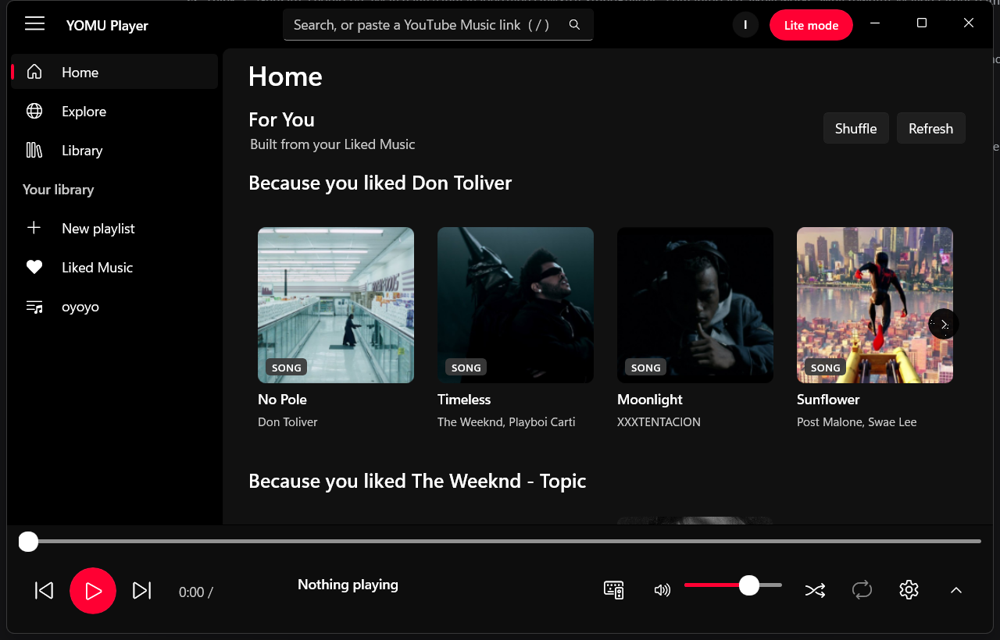
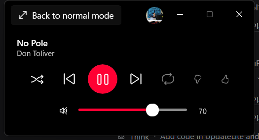
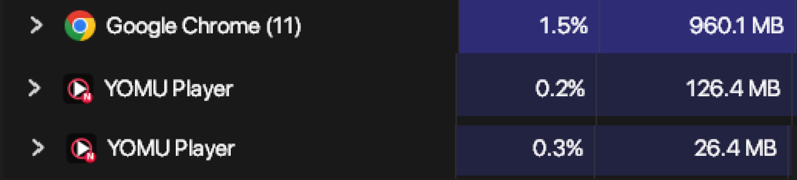

# YOMU Player

A lightweight YouTube Music client for Windows that feels like a Windows app — because it is one.

No Electron. No Chromium. No embedded web view. Just **native WinUI 3**, LibVLC for audio, and a small amount of C#.

<p align="center">
  <a href="https://github.com/kabouls/YOMU-Player/releases/latest">
    
  </a>
  &nbsp;
  <a href="https://github.com/kabouls/YOMU-Player/releases/tag/nightly">
    
  </a>
</p>

<p align="center">
  <a href="https://github.com/kabouls/YOMU-Player/actions/workflows/nightly.yml">
    
  </a>
  <a href="https://github.com/kabouls/YOMU-Player/actions/workflows/stable.yml">
    
  </a>
  
</p>



## Why YOMU?

Most desktop music clients are a browser in a trench coat. YOMU is not.

- **Actually native** — WinUI 3 + .NET 8, with real Windows controls, media keys and taskbar integration.
- **Light on its feet** — no web view, no DI container, no MVVM framework, bounded caches and lazy lyrics.
- **Lite mode** — shrink to a 420 × 228 mini player. It releases the page, thumbnails and timer, then trims the working set while playback keeps running.

<p align="center">
  
</p>

### The memory receipts

Task Manager, same machine, YouTube Music playing:

| App | Processes | Working set | CPU |
| --- | ---: | ---: | ---: |
| Chrome with YouTube Music | 11 | **960.1 MB** | 1.5% |
| YOMU Player | 1 | **126.4 MB** | 0.2% |
| YOMU Player in Lite mode | 1 | **26.4 MB** | 0.3% |

<p align="center">
  
</p>

Not a lab benchmark — just a quick Task Manager check while the same music was playing. But it is a pretty good picture of why the native approach exists.

## Download

Every release includes two flavours:

| Build | Best for |
| --- | --- |
| **Installer** | Normal use. Per-user install, Start Menu/Desktop shortcuts, easy updates. |
| **Portable ZIP** | Keep it on a USB stick or in a folder. No install, no shortcuts. |

Grab them from [Releases](https://github.com/kabouls/YOMU-Player/releases):

- **Stable** — the latest tagged stable release.
- **Nightly** — test builds from the `nightly` branch. Expect rough edges.

Requirements: **Windows 10 1809+ or Windows 11, x64**.

> [!NOTE]
> Builds are currently unsigned, so Windows SmartScreen may warn you the first time. The source is right here if you want to build it yourself.

## What it does

- **Home / Explore / Search** — Home, quick picks for signed-out users, For You and Liked Music for signed-in users, Explore shelves, rich search results.
- **Discovery rows** — “Because you liked X” plus a second “More like X” row that deliberately leaves X out. Pick a mood/genre to add a manual genre row to Home.
- **Your library** — Liked Music, liked songs, a playlist card grid, playlist editing, and a **local** recently-played history. History is stored on this PC only; it is not your YouTube account history.
- **Region-aware Explore** — Auto, Worldwide (no country filter), or a specific country for charts, new releases and browse shelves.
- **Playback** — song radio, album/playlist queues, autoplay, shuffle, repeat, quality selection, prefetching the next track.
- **Player page** — large artwork, a proper **Up next** queue and **Lyrics**, with the library sidebar still visible.
- **Like / dislike** — synced with your YouTube account. Disliking skips the song and keeps it out of generated recommendations and queues.
- **Lite mode** — tiny player that still handles transport, shuffle, repeat and volume.
- **Windows integration** — media keys and the volume flyout through SMTC, taskbar thumbnail buttons, single-instance `yomu://` links.
- **Paste a link** — paste a YouTube Music or YouTube link and the app previews what it will open first.
- **In-app updates** — a small **Update available** chip appears when a new build is ready. It downloads, verifies SHA-256, applies the update and shows the changelog once.
- **Changelog** — every release is listed in **Profile → Changelog**.

## Install

1. Download **YOMU-Player-Setup-\<version\>.exe** from [Releases](https://github.com/kabouls/YOMU-Player/releases).
2. Pick an install folder.
3. Choose whether to create Start Menu and Desktop shortcuts.
4. Click **Install**.
5. Leave **Launch YOMU Player** checked on the finish page.

The installer is per-user, so it does **not** ask for administrator access.

### Portable

Download the portable ZIP, extract it anywhere, and run `YomuPlayer.exe`.

Portable builds keep their data in a `data` folder next to the executable when the folder is writable. Google login is encrypted with Windows DPAPI for the current Windows user, so moving the folder to another PC means signing in again — that is intentional. No plaintext token is stored.

## Google account

Sign in from **Library** or **Profile**. The app opens your default browser, uses OAuth with PKCE and a loopback redirect, and never sees your Google password.

The refresh token is protected with Windows DPAPI in the app's data folder. Signing out removes the token from this PC; it does not delete your Google account or playlists.

If the OAuth app is in Google's testing mode, only test users can sign in and refresh tokens expire after 7 days. Publishing/verifying the OAuth app removes both limits. More details:

- [Google sign-in setup](docs/google-signin.md)
- [OAuth verification notes](docs/google-oauth-verification.md)

## Updates

YOMU has two channels:

```text
nightly  →  tested  →  main / stable
```

- **Nightly** builds from the `nightly` branch and checks `nightly.json`.
- **Stable** builds from tagged `v*` releases on `main` and checks `stable.json`.
- Update manifests and SHA-256 hashes are published through GitHub Pages.
- The app downloads updates directly, verifies the hash, and relaunches after installing.

Release/update implementation details: [docs/app-updates.md](docs/app-updates.md).

## Keyboard shortcuts

These work from anywhere in the YOMU window, including when a song card or the search box has focus.

| Keys | Action |
| --- | --- |
| `Space` / `K` | Play / pause |
| `N` / `Shift+N` | Next |
| `P` / `Shift+P` | Previous |
| `J` / `L` | Seek 10 s back / forward |
| `←` / `→` | Seek 5 s |
| `M` | Mute |
| `↑` / `↓` | Volume +/- 5% |
| `0`–`9` | Jump to 0–90% |
| `/` | Focus search |
| `Alt+←` / `Alt+→` | Back / forward |
| `Ctrl+V` | Open a copied link |
| Mouse back/forward | Back / forward |

### Media keys, macros and mouse buttons

YOMU handles the standard media keys and a focused-window fallback set, so hardware media buttons and macro pads work without extra software.

| Shortcut | Action |
| --- | --- |
| Media Play/Pause | Play / pause |
| Media Next | Next |
| Media Previous | Previous |
| Media Stop | Pause |
| `Ctrl+Alt+Space` | Play / pause |
| `Ctrl+Alt+→` / `Ctrl+Alt+←` | Next / previous |
| `Ctrl+Alt+↑` / `Ctrl+Alt+↓` | Volume +/- 5% |
| `Ctrl+Alt+M` | Mute |
| `Ctrl+Mouse back/forward` | Previous / next |
| `Ctrl+Middle click` | Play / pause |

Media keys use the Windows SMTC session in the background. The fallback combos and mouse shortcuts are deliberately limited to the focused YOMU window so they don’t steal input from games or other apps.

If your macro software can’t send media keys, bind it to one of the `Ctrl+Alt+…` combinations.

## Build from source

You need:

- Windows 10/11
- [.NET 8 SDK](https://dotnet.microsoft.com/download/dotnet/8.0)
- [Inno Setup 6.7+](https://jrsoftware.org/isdl.php) only if you want to build the installer
- yt-dlp — already bundled in release builds; source builds can use a copy on `PATH` or install one with `tools\install-fast-ytdlp.ps1`

```powershell
git clone https://github.com/kabouls/YOMU-Player.git
cd YOMU-Player

dotnet build src\YomuPlayer.Desktop\YomuPlayer.Desktop.csproj -c Debug
```

Run the app:

```powershell
.\src\YomuPlayer.Desktop\bin\Debug\net8.0-windows10.0.19041.0\win-x64\YomuPlayer.exe
```

The build is self-contained: Windows App SDK and LibVLC ship next to the EXE.

### Build release packages

```powershell
# Stable
.\tools\build-channel.ps1 -Channel stable -Version 1.0.0 -ReleaseNotes "Initial stable release."

# Nightly
.\tools\build-channel.ps1 -Channel nightly -Version 1.0.0-nightly.1 `
  -FileVersion 1.0.0.1 -ReleaseNotes "Nightly test build."
```

Artifacts land in `dist\`.

For source builds without the bundled OAuth client, see [docs/google-signin.md](docs/google-signin.md). Release builds include `google-client.json` so users only need to approve access in the browser.

## Project layout

```text
src/
  YomuPlayer.Core/        InnerTube, Data API, parsers, playback queue, stream resolution
  YomuPlayer.Audio.Vlc/   LibVLCSharp audio player
  YomuPlayer.Desktop/     WinUI 3 app: pages, player bar, lite mode, SMTC, updates
  YomuPlayer.Desktop/Auth OAuth + PKCE + DPAPI token store
  YomuPlayer.Cli/         parser/debug helper
  YomuPlayer.PlayCli/     playback smoke helper
installer/                Inno Setup script
tools/                    build-channel.ps1 and release helpers
docs/                     setup, update, distribution and privacy notes
```

### A few lightweight choices

- No web view and no embedded browser page.
- Bounded caches; no growing session caches.
- Lyrics are fetched only when the tab is opened.
- Artwork decode sizes match the UI.
- Lite mode frees the page and thumbnails.
- Stream URLs are prefetched for the next track.

## Troubleshooting

**No audio / “could not resolve stream”**  
Make sure `yt-dlp.exe` is next to the app or on `PATH`. Release builds normally bundle it.

**Google sign-in opens an error page**  
Check [docs/google-signin.md](docs/google-signin.md). If the app is in testing mode, your account must be a test user.

**SmartScreen warning**  
The build is currently unsigned. You can inspect the source and build it yourself, or wait for signed releases.

**Logs**  
`%LOCALAPPDATA%\YomuPlayer\log.txt`  
Portable: `data\log.txt` next to the app.

## Contributing

Found a bug or have an idea? Open an issue:

- [Issues](https://github.com/kabouls/YOMU-Player/issues)
- [Pull requests](https://github.com/kabouls/YOMU-Player/pulls) — target `nightly` for new work.

Small fixes, memory wins and “this feels janky” reports are all welcome.

## Credits & disclaimer

YOMU uses [LibVLCSharp](https://github.com/videolan/libvlcsharp), [yt-dlp](https://github.com/yt-dlp/yt-dlp), the YouTube Data API and anonymous InnerTube endpoints.

Not affiliated with YouTube, Google, or VideoLAN. Use it with your own account and content, and review YouTube's Terms of Service before distributing builds that resolve streams.
